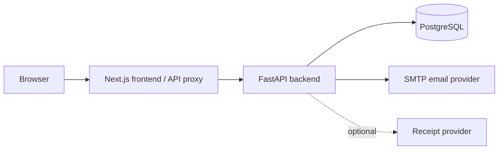

# RoommateLedger

A full-stack expense tracker for roommates. Keep personal spending private, split shared costs fairly, and see balances based on what each person paid and owes.

Watch the [silent product demo](https://saujanparajuli.com/#projects).

This public source snapshot starts a new Git history. Staging branches and
historical commit/tag references in the documentation describe private development;
they are not branches or tags in this public copy.

## Why I built it

A grocery receipt does not always belong in one equal split. Everyone might share rice, two people might share meat, and one person might buy shampoo. I built RoommateLedger to handle those differences and practice connecting a useful interface to account security, database transactions and accurate calculations.

## What the app can do

- Register, verify an email, sign in, reset a password and manage a profile.
- Create a household and invite roommates with single-use invitations.
- Track private expenses and split shared costs equally, by fixed amounts or by percentages. Selected-member splits change who pays, not who can read a shared expense: current household members can see shared history.
- Review expense history, spending reports, CSV exports and recurring templates.
- Review receipt items before confirming allocations; manual entry works without a receipt provider.
- Calculate balances and record repayments made outside the app. The app does not move money.

## Tech stack

| Part | Technologies |
| --- | --- |
| Frontend | Next.js, React, TypeScript |
| Backend | FastAPI, Python 3.13, SQLAlchemy, Pydantic |
| Database | PostgreSQL 17, Alembic |
| Tests and builds | pytest, Vitest, Playwright, Ruff, Docker, GitHub Actions |
| Private staging | Vercel protected Preview, Render Free, Neon Free, Mailtrap Sandbox |

## How it works



The backend checks access and calculates shares before committing a transaction. PostgreSQL stores the ledger, sessions and membership history. A roommate cannot read another person's private expenses. Receipt drafts have no effect on balances until the user confirms them.

## Important technical work

- **Keeping every cent:** money uses integer cents and `Decimal`, not floating-point dollars. Splitting $100 among three people gives $33.34, $33.33 and $33.33. Equal, fixed and percentage splits must conserve the total.
- **Checking access on the server:** private/shared rules, household membership and expense ownership apply to reads, writes and exports.
- **Protecting accounts:** server-side sessions, CSRF checks, email verification, expiring invitation/reset tokens and session revocation protect account actions.
- **Handling retries and concurrent changes:** financial request keys prevent duplicate records on a retry. Transaction locks define whether a write happens before or after a membership change.
- **Operating the database carefully:** Alembic tracks schema changes; staging checks database identity and verified TLS. Production has a separate migration command, bounded database waits and sanitized startup/release logging.
- **Testing failure cases:** PostgreSQL tests cover rollback, privacy, exact allocations and concurrent requests. Rate limits and anonymous-session caps protect database resources. Docker and browser tests check the full flow.

## Project structure

```text
backend/       API, services, migrations and PostgreSQL tests
frontend/      Web app, browser/unit tests and local demo recorder
deploy/        Private staging deployment configuration
docs/          Design, verification, operations and resume checklist
reference/     Retired Spring backend, kept as a migration reference
```

## Run locally

With Docker running:

1. Copy `.env.example` to `.env` and choose a local database password.
2. Keep the development defaults, then run:

   ```sh
   docker compose --profile app up --build -d
   ```

3. Open http://localhost:3000. No email or receipt-provider credentials are needed for local manual entry.
4. Stop with `docker compose down`; this keeps the database volume.

For native development, use Python 3.13, uv and PostgreSQL 17 with the [backend instructions](backend/README.md), then run `npm ci` and `npm run dev` from `frontend/` with Node.js 24. Native commands do not load the root `.env` automatically. See [deployment notes](docs/deployment.md).

For a repeatable local video with fictional data, see the [demo guide](docs/demo.md).

## Testing

The hardening phase recorded **243 backend tests**, **14 frontend unit tests** and **5 browser tests** passing, plus Ruff, frontend lint/typecheck/build, Docker builds and isolated TLS/startup checks. These are local/repository verification results, not proof of the latest hosted deployment. See [verification history](docs/verification.md).

From `backend/`, run `uv run pytest -q` and the Ruff checks in its README. Tests must use an isolated `ledger_pytest_*` PostgreSQL database: they clear test data and create temporary migration databases. Never use a hosted or personal ledger. From `frontend/`, run `npm run lint`, `npm run typecheck`, `npm run test` and `npm run build`. Browser prerequisites and local email testing are in [release operations](docs/release-operations.md).

## Staging deployment

Private staging was verified on **2026-09-11** on an earlier backend version: accounts, household invitations, private/shared expenses, equal splits, balances and refresh persistence passed. The [staging checklist](docs/staging.md#verified-staging-checklist) records the exact commit and scope.

Staging remains private and **$0/month** on Vercel protected Preview, Render Free, Neon Free and Mailtrap Sandbox. Mailtrap captures test email; it does not provide production email delivery. Receipt AI is disabled there, with manual entry available.

## Current status

The core application is implemented and extensively tested, with enough features for a private demo. Later production hardening added retry protection, membership concurrency controls, database timeouts and safer release tooling.

That hardening code is on `main` and has been merged into `staging`, but **the latest backend still needs a Render staging redeploy and hosted smoke test**. The earlier hosted result does not verify the newer code.

Public production is not launched. The remaining work is mainly production infrastructure, email delivery, monitoring, backups, load testing and public-user policies. The [project summary](docs/project-summary.md) records what is complete and the next steps.

## Future work

- Redeploy the latest hardening to hosted staging and complete its smoke test first.
- Review production ingress/network design, separate infrastructure and real email delivery.
- Prove backups/restores, monitoring/alerts, load behavior and dependency/security scanning.
- Define privacy, retention and support policies; improve accessibility and mobile usability.
- Consider optional receipt AI only after cost, privacy and accuracy review.

## Documentation

- [Project summary and resume checklist](docs/project-summary.md) · [Local demo](docs/demo.md)
- [Architecture](docs/architecture.md) · [API](docs/api.md) · [Migration history](docs/python-migration.md)
- [Staging](docs/staging.md) · [Verification](docs/verification.md) · [Changelog](CHANGELOG.md)
- [Production audit](docs/production-audit.md) · [Hardening](docs/production-hardening.md)
- [Production runbook](docs/production-runbook.md) · [Release operations](docs/release-operations.md)
