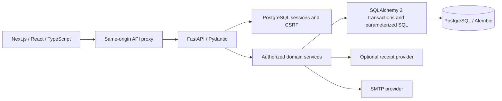

# Architecture

The application uses a Next.js same-origin API proxy. The proposed production design retains that boundary, but public production is not deployed and its ingress design remains blocked. Explicit trusted proxy CIDRs control anonymous rate-limit identity; the launcher disables implicit forwarded-header trust. Provider deadlines are configurable and server-generated request IDs correlate safe errors with logs. See [release operations](release-operations.md).

## Boundaries

Routes validate Pydantic input and delegate to cohesive services. Explicit profile, expense, allocation and receipt response schemas prevent uncontrolled persistence objects from becoming API contracts. SQLAlchemy sessions delimit request transactions, committing before successful responses leave the endpoint. Domain/validation/integrity failures roll back all writes. Reporting uses parameterized SQL aggregation; models map the existing relational tables without replacing the schema with a new design.

The frontend's existing forms and same-origin API client remain intact. Money input parses decimal strings into integer cents. Reports have charts and accessible tables; dialogs and responsive navigation remain in React.

## Financial rules

Authoritative Python values are Decimal cents; database amounts are NUMERIC(14,0), and JSON uses integer cents. This retains all historical units without conversion/rounding. Single-expense amounts are positive and at most 100,000,000,000 cents. Equal and percentage allocations use deterministic remainder distribution; percentages total exactly 10,000 basis points and fixed amounts equal the expense. UUID tie order matches Java's signed 64-bit halves, preserving the original allocation contract.

`balance = paid - allocated responsibility + repayments sent - repayments received`

PERSONAL has no household, and payer equals owner. Shared creator, payer and selected participants must have belonged on the expense date. HOUSEHOLD resolves participants from dated membership intervals. The final membership day is inclusive. Current members can read shared history; former members lose household access while prior shares remain unchanged. Personal analytics includes only the authenticated user's finalized responsibility.

## Transactions and immutable history

Expense edits lock the row, validate optimistic version and preserve scope/household. Only the creator edits/deletes. Soft deletion retains the record and audit trail. Confirmed receipt items cannot be edited or deleted.

Receipt confirmation locks the private receipt, reconciles item totals plus fees/tax minus discounts, allocates adjustments, creates every item expense/allocation/audit entry, and marks confirmation in one transaction. A failed second item rolls back the first. Concurrent confirmation creates expenses exactly once. Unconfirmed receipt data has no financial effect. Complete mixed-receipt audits remain private.

Recurring templates and generated expenses are separate. Recording locks the template, materializes a unique template/due-date expense and advances a calendar interval. Editing a template cannot rewrite old expenses. No background scheduler creates obligations.

Financial creation requests now support user/operation-scoped idempotency receipts
in the same transaction as the write. Production requires a key. A shared/exclusive
transaction gate defines the membership-versus-write cutoff. See the
[hardening contract](production-hardening.md) for replay retention and lock tradeoffs.

## Authentication and operations

BCrypt cost 12 retains compatibility with existing password hashes. A random 256-bit opaque JSESSIONID is stored only as a SHA-256 lookup hash in PostgreSQL; CSRF uses a separate synchronizer token. Login rotates the session identifier while retaining the established CSRF contract. HttpOnly/SameSite cookies, Secure in production, configurable idle expiry and account session-version checks support logout/revocation across workers and restarts. No authentication secret is stored in localStorage.

PostgreSQL rate windows commit separately so failed requests count and multiple workers share limits. Direct peer addresses are used for anonymous requests unless a trusted ingress supplies a deliberately configured proxy chain. Deploy per-client ingress limiting when the Next.js proxy aggregates client addresses. Expired sessions/tokens/windows are cleaned during relevant operations.

Reset and verification links are single-use hashed tokens with 30-minute and 24-hour expiry. SMTP requires certificate-verified STARTTLS in production. Deactivation keeps ledger rows, ends memberships, pauses owned recurring templates and expires invitations.

The API exposes minimal liveness/readiness responses and safe reference-bearing errors. Readiness checks PostgreSQL and Alembic head. Request bytes, decoded images, provider bodies and provider duration are bounded. Production secrets come from environment configuration. No SQL parameter values, passwords, receipt text or reset tokens are logged by application error handling.

## Schema ownership

Alembic owns forward migrations. Its baseline executes preserved V1–V3 SQL for a fresh database, or verifies an existing Flyway schema before adoption. It checks columns, nullability, defaults, checks, keys and indexes, retains Flyway history and fails on unknown/drifted schemas. A scratch schema containing only reference DDL supports comparison and is removed within the migration transaction. Forward migration casts BIGINT cents exactly to NUMERIC cents and adds session/rate tables. Migration runners use a PostgreSQL advisory transaction lock.

Review every future migration against the established constraints; do not blindly apply autogenerated changes or downgrade into data loss. See [migration procedure](python-migration.md).
