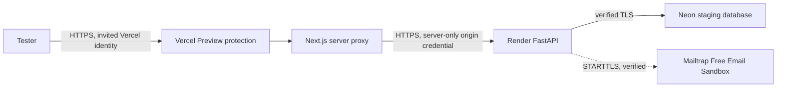

# Private staging: Vercel Preview, Render and Neon

Commit references use the privacy-rewritten equivalents of the original tested
versions. Their source trees are identical; rewriting metadata did not deploy or
re-verify hosted staging.

**Verified on 2026-09-11 by the owner.** Vercel protected Preview, Render Free,
Neon PostgreSQL 17 and Mailtrap Email Sandbox are working together. The successful
backend deployment is `d8f6a5f74b1438f9d268c3b680346b6c5a2eb001`.
Only invited testers may access staging. Public production and real recipient
email delivery are separate future work; see the [production readiness plan](production-runbook.md).

## Latest hardening: hosted verification pending

The code from `6b314fe08daca21af6a8c2da57f61f8d8ce4ccaf` is on main and was
merged into staging by `54848781fbe999a1394d46ff3fc3198885a0a888`. It passed
local/repository verification, but the latest backend has **not** yet been
redeployed and smoke-tested on hosted Render staging. A newer Preview or branch
push does not extend the earlier hosted verification below. Resume with the
[ordered deployment checklist](project-summary.md#exact-next-steps-when-development-resumes).

## Verified staging checklist

These checks record the owner's live verification report, not a new provider
inspection during the documentation cleanup. Local regression evidence is in
[verification](verification.md).

- [x] GitHub CI.
- [x] Vercel protected Preview.
- [x] Vercel-to-Render API proxy and deployment proxy key protection.
- [x] Render Docker build, application startup and backend readiness.
- [x] Neon PostgreSQL 17 and expected `roommateledger_staging` database identity.
- [x] TLS `verify-full`, CA validation and client-side libpq TLS verification.
- [x] Alembic migrations.
- [x] Mailtrap Email Sandbox with STARTTLS.
- [x] Registration, email verification and login/session.
- [x] Household creation and roommate invitation.
- [x] Private expense creation and persistence.
- [x] Shared expenses, equal splits and balances.
- [x] Data persistence after page refresh.
- [x] AI intentionally disabled; manual entry/fallback available.
- [x] No paid staging services introduced; staging remains $0/month.

This checklist does not claim live password-reset testing, settlement testing,
receipt-upload size testing, restore testing, load testing or production email
delivery. Keep those separate from the verified flows above.

## Selected $0/month setup

| Component | Selected tier | Cost policy |
| --- | --- | --- |
| Frontend/access gateway | Vercel **Hobby**, protected **Preview**, provider-generated URL | $0 within free limits; invited identities only. No Pro trial, paid seats or protection add-ons. |
| Backend | Render **Free Web Service**, one Docker instance | $0 within free allowances; sleep/cold starts accepted. No paid compute, disk, jobs or upgrades. |
| PostgreSQL | **Neon Free** project, PostgreSQL 17 | Separate `roommateledger_staging` database; no paid autoscaling/plan. |
| Email | **Mailtrap Free Email Sandbox**, STARTTLS port **2525** | Private captured test mail only; no real delivery or paid sending product. |
| AI | Disabled | No OpenAI/provider keys configured; manual receipts remain available. |

**Hard limit: $0/month. Stop if any signup/setup asks for a credit card, payment,
paid tier, trial converting to paid, or charge.** Do not add a payment method or
upgrade to get past a limit. Review the account billing page and existing payment
methods before resource creation: a free instance alone does not rule out billable
workspace overages. Use free spending controls where offered; stop if the account
cannot guarantee no charges. No provider signup/card screen was inspected here.

Render sleeps after inactivity and may take about a minute to wake. Its free
allowance is shared across workspace services; build/bandwidth limits can suspend
service or builds. No always-on ping/cron workaround is part of this plan. Free
has no shell, one-off jobs or pre-deploy command, so guarded migrations run in
container startup. Mailtrap supports 2525; Render documents blocks on 25/465/587,
not 2525. Outbound STARTTLS to the sandbox passed live testing. If it later fails,
stop and report it rather than upgrading or disabling TLS.
[Render free limits](https://render.com/docs/free),
[Render deploy commands](https://render.com/docs/deploys#pre-deploy-command),
[Mailtrap SMTP help](https://docs.mailtrap.io/email-sandbox/help),
[Neon pricing](https://neon.com/pricing), [Mailtrap plans](https://mailtrap.io/pricing/).



The Render hostname is internet-routable, but application endpoints require a
server-only deployment credential. The frontend replaces client-supplied copies;
the API checks it in constant time, then retains normal session authentication,
CSRF and authorization. Only read-only health/readiness probes are public. This
is protected application ingress, **not a network-private backend**. No secrets
belong in browser bundles, URLs or `NEXT_PUBLIC_*` variables.

Vercel Hobby Standard Protection gates Preview URLs but leaves Production domains
public. Use only a protected Preview URL and explicitly approve tester identities;
avoid shareable bypass links. The frontend additionally returns 404 if this gated
setup runs on Vercel outside Preview. Preview protection passed owner testing; keep it enabled and retest after access changes. [Vercel deployment protection](https://vercel.com/docs/deployment-protection).

## Configuration audit

Reviewed: backend Settings, launcher, request/session/CSRF boundaries, proxy address
handling, health checks, SMTP transport, receipt adapters, Alembic, both Dockerfiles,
Compose, frontend API client/Next configuration and GitHub Actions. No schema or
product behavior changes are required. The optional origin gate is deployment-only.

Python does not automatically load `.env`. Root `.env.example` is for local
development and contains unsafe-for-staging defaults. Required below means required
for this deployment even if code supplies a development default.

| Classification | Variables | Value/policy |
| --- | --- | --- |
| Required, backend secret | `DATABASE_URL` | New Neon **direct/non-pooler** connection string, dedicated staging database. Use `sslmode=verify-full&sslrootcert=/etc/ssl/certs/ca-certificates.crt`, retaining provider channel-binding options. Never a local URL. |
| Required only if credentials absent from URL | `DATABASE_USER`, `DATABASE_PASSWORD` | Dedicated staging credentials; embedded URL credentials take precedence. Omit these when using Neon's full credential-bearing URL. |
| Required, both services | `FRONTEND_URL` | Exact protected HTTPS Preview origin, no trailing slash/path. Backend uses it for email links. Update when the accepted Preview hostname changes. |
| Required, frontend | `API_INTERNAL_URL` | Exact Render HTTPS origin, no path, query or credentials. Despite its name this recipe uses a public HTTPS origin protected by the origin gate. Rebuild after changing it. |
| Staging/production-only, both | `APP_ENV` | `staging`. Backend rejects unknown values; frontend receives it during build. |
| Required for this public-origin topology, both | `DEPLOYMENT_PROXY_REQUIRED`, `DEPLOYMENT_PROXY_KEY` | `true` and the same random secret of at least 32 characters (generated by the provider; the Blueprint requests generation in Render). Backend runtime + Vercel server environment only. Never hardcode or pass as a URL. |
| Staging/production-only, backend | `COOKIE_SECURE`, `COOKIE_SAME_SITE` | `true`, `lax`. Existing cookies are HttpOnly, Path=/, host-only; do not widen Domain. |
| Staging/production-only, backend | `EMAIL_VERIFICATION_REQUIRED`, `SMTP_STARTTLS` | Both `true`. Missing SMTP is a startup/acceptance blocker; never switch to development to bypass it. |
| Staging/production-only, backend | `SMTP_HOST`, `SMTP_PORT`, `EMAIL_FROM` | Real provider settings, `sandbox.smtp.mailtrap.io`, **2525**, `ledger-staging@example.test` (sandbox-only sender). Real delivery is not configured. Port 465 implicit TLS is not supported. |
| Required by authenticated SMTP, backend secret | `SMTP_USERNAME`, `SMTP_PASSWORD` | Mailtrap Sandbox SMTP credentials, entered only into Render environment secrets. Do not invent or put them in chat. |
| Optional, deliberately empty | `CORS_ALLOWED_ORIGINS` | Empty: browser uses relative same-origin `/api`. CORS does not protect backend ingress. Direct browser-to-API calls are not this topology. |
| Optional, deliberately empty | `TRUSTED_PROXY_CIDRS` | Empty until all controlled proxy hops/header sanitization are proven. Never trust `0.0.0.0/0`, `::/0`, arbitrary forwarded headers or a broad shared provider network. |
| Optional runtime | `HOST`, `PORT` | Backend `0.0.0.0`, `8080` in Blueprint; Vercel manages frontend listening. |
| Optional backend tuning | `SESSION_TIMEOUT_SECONDS` | Default 1800, allowed 60-86400. |
| Optional backend tuning | `SMTP_TIMEOUT_SECONDS`, `RECEIPT_TIMEOUT_SECONDS` | Defaults 5 and 45; allowed 1-30 and 1-120. Cold-start waiting is separate from SMTP/extraction timeouts. |
| Optional backend rate controls | `RATE_WINDOW_SECONDS`, `RATE_LOGIN`, `RATE_REGISTRATION` | Defaults 900, 20, 20. With empty proxy trust anonymous limits aggregate behind the frontend; retain security and use small test batches/edge controls. |
| Optional backend rate controls | `RATE_PASSWORD_RESET`, `RATE_RESET_CONFIRM`, `RATE_VERIFICATION` | Defaults 5, 10, 5. |
| Optional backend rate controls | `RATE_INVITATIONS`, `RATE_EXTRACTION`, `RATE_ACCOUNT` | Defaults 10, 10, 5. All RATE settings accept 1-86400. |
| Optional AI | `RECEIPT_PROVIDER` | `adapter` with empty provider keys disables automated extraction; manual review/entry remains available. |
| Optional AI, backend only | `RECEIPT_PROVIDER_URL`, `RECEIPT_PROVIDER_API_KEY`, `OPENAI_API_KEY`, `OPENAI_RECEIPT_MODEL` | Empty initially. Later configure either HTTPS adapter + key, or `RECEIPT_PROVIDER=openai` + real key + explicit supported model. |
| Development-only | `DEMO_PASSWORD` | Unset; demo seeding rejects staging/production. |
| Development-only defaults | localhost/HTTP frontend, `COOKIE_SECURE=false`, `SMTP_STARTTLS=false`, `EMAIL_VERIFICATION_REQUIRED=false` | Never copy these into staging. |
| Local/CI test-only | `TEST_DATABASE_URL`, `TEST_DATABASE_USER`, `TEST_DATABASE_PASSWORD`, `TEST_MAILBOX_URL`, `TEST_MAILBOX_TOKEN`, `CHROME_PATH`, `CI` | Not hosted service settings. pytest clears its test database; never point it at staging. Do not deploy the local mailbox. |
| Operator-only smoke settings | `E2E_BASE_URL`, `SMOKE_FRONTEND_URL`, `SMOKE_BACKEND_URL`, `SMOKE_ALLOW_MUTATIONS`, `SMOKE_EMAIL_DOMAIN`, `SMOKE_LOCAL_MAILBOX_URL`, `SMOKE_LIVE_AI`, `LIVE_RECEIPT_FILE` | Test runner only. Existing smoke tools do not automatically authenticate through Vercel protection or the new origin gate. |
| Provider/image-managed | `VERCEL`, `VERCEL_ENV`, `NODE_ENV`, `HOSTNAME`, `NEXT_TELEMETRY_DISABLED`, `PATH`, `PYTHONDONTWRITEBYTECODE`, `PYTHONUNBUFFERED`, `UV_COMPILE_BYTECODE` | Preserve provider/image values. Do not spoof Vercel environment classification. |

There is no application `BACKEND_URL`, JWT signing secret or `ALLOWED_HOSTS`
setting. The Python launcher disables implicit forwarded-header trust. Configure
hostnames at the provider; do not invent ignored trusted-host variables. HSTS and
frontend security headers are produced by staging builds. API responses remain
no-store; never enable CDN caching for API/session responses.

## Setup reference for recreating staging

The working resources already exist. These instructions are a reference for an
intentional rebuild, not a request to create duplicates or reset the database.
Only the owner should change provider resources. Stop at any card or charge
screen; do not enable trials or upgrade plans.

### 1. Mailtrap Free Email Sandbox

1. Sign up at [Mailtrap](https://mailtrap.io/) and choose **Email Sandbox Free**,
   not Email API/SMTP Sending, Marketing, a paid plan or a paid trial.
2. Open the sandbox project/inbox (create one if the free account has none).
   In **Integration > SMTP**, select the Python/smtplib example or SMTP settings.
3. Confirm host `sandbox.smtp.mailtrap.io`, port **2525**, STARTTLS enabled.
   Its sandbox username/password will later go into **Render > Environment** as
   `SMTP_USERNAME` and `SMTP_PASSWORD`. Leave them in the provider dashboard for now.
   Never copy credentials into chat, repo files, screenshots or terminal commands.
4. Use `EMAIL_FROM=ledger-staging@example.test` for captured sandbox messages.
   No custom sender domain is needed for this sandbox recipe. This address is
   not a verified real sender, and messages will not reach recipient inboxes.
5. Share only the sandbox/inbox ID or dashboard URL, if useful. Only authorized
   test operators should read captured verification/reset links. Do not make the
   inbox public or share its credentials with general testers.

Keep `SMTP_STARTTLS=true` and `EMAIL_VERIFICATION_REQUIRED=true`. Registration,
verification, reset and invitation flows can be tested using captured messages;
external deliverability remains unverified. Sandbox message/retention limits may
interrupt tests. Do not switch off verification when the quota is exhausted.

### 2. Neon Free staging database

1. Sign up at [Neon](https://console.neon.tech/) on **Free**, with no payment method.
2. Create a **new empty project** `roommateledger-staging`, PostgreSQL **17**,
   region near Render Ohio. Create database **`roommateledger_staging`** and a
   dedicated role. Do not import development data or branch from production.
3. In **Connect**, choose that database/role and a **direct/non-pooler** connection.
   The full URL is a secret: it goes only in **Render > Environment > DATABASE_URL**.
   Set `sslmode=verify-full` and
   `sslrootcert=/etc/ssl/certs/ca-certificates.crt`, retaining provider
   channel-binding options. Keep the full `.neon.tech` hostname, not an IP.
4. Review Free compute/storage limits and avoid paid upgrades/autoscaling options.
   Share only project ID and non-secret hostname, never the full connection URL.

### 3. Vercel Hobby protected Preview bootstrap

1. In the existing Hobby account, import `parajulisaujan/roommate-ledger`, Root
   Directory **`frontend`**, framework **Next.js**, Node.js **24**, install
   `npm ci`, default Next.js output (not static export).
2. Before exposing a Preview, configure **Settings > Deployment Protection >
   Vercel Authentication > Standard Protection**. Grant only explicitly authorized
   tester identities. No shareable bypass links, public exceptions or paid seats.
   If the free account cannot grant the needed tester access, stop and report it.
3. In **Settings > Environment Variables**, set `DEPLOYMENT_PROXY_REQUIRED=true`
   for **Preview and Production**. Public Production then returns 404. Set
   `APP_ENV=staging` for **Preview** only. Leave the backend URL/key unset until
   Render is created: the protected proxy returns 503 and cannot forward traffic.
4. For Preview builds, set the build command to:

   ```sh
   FRONTEND_URL=https://$VERCEL_BRANCH_URL npm run build
   ```

   `VERCEL_BRANCH_URL` is Vercel's non-secret generated branch hostname. Enable
   automatic system environment variables if necessary. On Production builds
   this does not grant access; the runtime still rejects non-Preview deployment.
   After the Preview exists, explicitly set its accepted origin as `FRONTEND_URL`
   in Preview settings as well. No custom domain is required.
5. Create GitHub branch **`staging`** from the approved green `main` commit in the
   branch selector; let Vercel create a **Preview** for it. Do not promote it to
   Production. Keep this branch a fast-forward of main; never force push.
6. Confirm an incognito/non-invited identity cannot load the Preview or API, and
   an allowed identity can load the frontend. API-not-configured 503 is expected
   during bootstrap; registration and data workflows are not yet available.
   Share the generated stable Preview/branch HTTPS URL, project ID and commit SHA.

### 4. Render Free Web Service

1. Sign up at [Render](https://dashboard.render.com/). Stop if a card is required.
   Confirm the workspace is free and has no billing setup that permits overages.
2. Choose **New > Web Service**, connect only the private
   `parajulisaujan/roommate-ledger` repository as `parajulisaujan`, branch `main`,
   runtime **Docker**, region **Ohio**, instance **Free**. Do not create Render
   Postgres; the database is the separate Neon Free project.
3. Leave repository Root Directory empty. Dockerfile path **`backend/Dockerfile`**,
   Docker build context **`backend`**, Docker command:

   ```text
   /app/.venv/bin/python -m app.staging_start
   ```

   No pre-deploy command, disk, one-off job or paid shell. Set health path
   **`/actuator/health/readiness`**, auto-deploy **Off**. The versioned equivalent
   is `deploy/render-api.yaml` with `plan: free`. If using Blueprint creation,
   select that path and verify it shows only one Free service; stop if it asks
   for a card. Do not use a paid plan to make Blueprint creation proceed.
4. Set these values in **Render > Environment** before deploying:

   | Variable | Enter in Render |
   | --- | --- |
   | `APP_ENV` | `staging` |
   | `HOST`, `PORT` | `0.0.0.0`, `8080` |
   | `DATABASE_URL` | Secret Neon direct URL with verified TLS from step 2 |
   | `FRONTEND_URL` | Actual protected Vercel Preview origin from step 3 |
   | `DEPLOYMENT_PROXY_REQUIRED` | `true` |
   | `DEPLOYMENT_PROXY_KEY` | The Blueprint generates this secret in Render automatically. For manual creation use the provider's secret generator (at least 32 characters); if unavailable, report that limitation. Store only in provider secret managers; do not paste into chat. |
   | `COOKIE_SECURE`, `COOKIE_SAME_SITE` | `true`, `lax` |
   | `CORS_ALLOWED_ORIGINS`, `TRUSTED_PROXY_CIDRS` | Empty |
   | `SMTP_HOST`, `SMTP_PORT` | `sandbox.smtp.mailtrap.io`, `2525` |
   | `SMTP_USERNAME`, `SMTP_PASSWORD` | Mailtrap Sandbox SMTP secrets from step 1 |
   | `EMAIL_FROM` | `ledger-staging@example.test` (sandbox only) |
   | `SMTP_STARTTLS`, `EMAIL_VERIFICATION_REQUIRED` | `true`, `true` |
   | `RECEIPT_PROVIDER` | `adapter` |
   | `RECEIPT_PROVIDER_URL`, `RECEIPT_PROVIDER_API_KEY`, `OPENAI_API_KEY`, `OPENAI_RECEIPT_MODEL` | Empty; no paid AI |

5. Create only if the final selection is **Free/$0**, with no card or payment.
   Startup validates the staging database name, Neon hostname, verified TLS/CA,
   required origin gate, Mailtrap sandbox and disabled AI before connecting.
   It verifies actual database identity and TLS before Alembic's locked migration,
   then starts the API in the same process. Migration failure prevents serving.
6. Read **Logs**, available on Free. Require the message
   `PASS staging database identity, TLS and Alembic upgrade`, successful API
   startup, and readiness 200/UP. Free has no dashboard Shell: do not upgrade to
   execute checks. The API health endpoints and sanitized startup log are the
   verification path. Neon SQL Editor can read `SELECT version_num FROM alembic_version`
   in the staging database; expect `0002_decimal_sessions`. Do not run destructive SQL.
7. Share only the service ID, generated HTTPS `onrender.com` URL and deployed SHA.

### 5. Connect Preview to Render and test

1. In **Vercel > Settings > Environment Variables > Preview**, set
   `API_INTERNAL_URL` to the Render HTTPS origin, and copy the same
   `DEPLOYMENT_PROXY_KEY` directly from its secret manager. Keep both Preview-only;
   never use `NEXT_PUBLIC_*`. Set `FRONTEND_URL` to the accepted Preview origin.
2. Redeploy the same approved commit as a **Preview**. Confirm Render uses that
   same `FRONTEND_URL` and commit; do not publish/promote a Production domain.
3. Wake the backend by opening its read-only `/health` and
   `/actuator/health/readiness`. Allow a few minutes on first deployment/cold start;
   then verify both expected JSON responses, not a provider loading page.
4. Test the acceptance checklist below through the protected Preview. Inspect
   Render logs and the browser network/console. Mailtrap messages must appear
   in its **private sandbox**, and verification/reset links must point to the
   protected Preview. No external recipient delivery or live AI is claimed.

## Free startup and operational limits

Migrations run on every container start, including wake/restart, and are idempotent
under the existing advisory lock/transaction. They never reset the database.
The default development Docker command is unchanged; only the Free staging
service uses `app.staging_start`. Startup errors are redacted. Fix configuration
or migration problems; do not disable verification/TLS or use the local database.

Render Free has an ephemeral filesystem; all ledger/session data remains in
Neon. Use small, fictional staging data and inspect free usage dashboards. Avoid
keep-alive pings. Cold starts and quotas may require waiting or pausing tests;
never resolve these by buying capacity. Never store backup files containing data
or credentials in the repository. Free recovery retention is limited.

## Additional acceptance checks for future releases

This is a test procedure, not a list of completed live checks. The verified
subset is recorded at the top of this document.

| Check | Passing evidence |
| --- | --- |
| Private gateway | Incognito and non-invited identities cannot load Preview HTML or `/api/health`; invited identities can. Accidental Production URL returns 404. Direct Render `/api/auth/register`, `/api/auth/csrf`, `/api/households` fail without the origin credential. |
| HTTPS/health | Valid frontend and backend certificates; backend `/health` returns 200/ok, `/actuator/health/readiness` 200/UP; invited frontend `/api/health` returns 200/ok. |
| Cookies/CORS | Browser session cookie Secure/HttpOnly/SameSite=Lax, no Domain; all browser API calls same-origin; no CORS or cookie errors; logout removes session cookie. |
| Credential handling | Network responses and client bundles contain no deployment proxy key or internal middleware credential headers. CSRF headers/cookies reach API. Never save raw HAR/credential screenshots. |
| Accounts/SMTP | Two disposable accounts verify using actually received emails (or explicitly documented private sandbox capture); login/logout, verification gate, reset and session revocation work. Record external delivery separately. |
| Household/privacy | A creates household and invites B; single-use join succeeds; A's personal expense is absent from B's lists/export and forbidden by direct expense-ID request. |
| Exact shared expense | A pays $100 shared equally between A/B; each responsibility is 5000 cents; B owes A $50. If practical, add third tester and verify $100 splits 3334/3333/3333. |
| Balances/settlement | Record B paying A $50; both net balances become zero. No real money is moved. |
| Manual receipt | With AI disabled, upload an authorized small JPEG/PNG/WebP, manually edit items/splits, reconcile and confirm once; duplicate confirmation creates no duplicate expense. |
| Proxy upload limits | Test representative multipart receipts and a near-8-MiB image end-to-end. Platform request limits/timeouts require live validation; do not claim local tests establish Vercel compatibility. |
| Persistence | Logout/login both users and read back records; restart staging API, recheck readiness and data without resetting DB. |
| Responsive/errors | 375/430/768/1024/1440px; usable forms/navigation, no overflow, unexpected console/network errors or backend/frontend exceptions. Inspect redacted provider logs and request IDs. |
| Release evidence | Both services run the same approved SHA; retain test date/results and redacted logs privately. Test backup restoration into another isolated database. |

Existing hosted smoke/Playwright tools assume their own mailbox integration and
do not automatically authenticate through Vercel protection and the origin gate.
Use authenticated browser acceptance, startup logs and public read-only health probes first. Do not disable the
gateway, publish the local mailbox or claim unchanged automation covers live staging.
Add narrowly scoped automation support only after the selected access/mailbox
providers are connected. AI remains disabled; no live extraction claim is made.

## Subsequent release/rollback

Push normally to main; require both GitHub Actions jobs green, back up staging,
deploy the API's exact commit/migrations, verify readiness, then update the staging
branch/Preview to that commit and repeat acceptance. Keep auto-deploy off until
this sequence is demonstrated. Roll back code only to a schema-compatible SHA;
do not downgrade Alembic. Restore into a new isolated database if needed.
Rotate the origin credential on both services together and redeploy Preview;
older protected deployments with the previous key will cease reaching the API.

Staging is verified. Keep its resources private and separate from any future
production deployment. Share only non-secret service/project IDs; never secrets.


## Troubleshooting

Startup now emits fixed `STAGING START`, `STAGING PASS`, and `STAGING FAIL` labels.
No setting values, SQL, usernames, connection strings, exception messages or
tracebacks are included. If multiple FAIL lines appear, read the innermost/first
failure first. These codes identify the next check in the provider dashboard:

| Code | Meaning / action |
| --- | --- |
| `settings_validation` | Settings parsing or general security validation failed. Check types, HTTPS frontend origin, secure cookies, verification, SMTP STARTTLS, and proxy-key presence/length privately. |
| `staging_configuration` | Free-staging restrictions failed: exact database name, Neon hostname, TLS URL options, Mailtrap sandbox/2525, ingress protection, or disabled AI. |
| `ca_bundle` | Required CA file is missing, unreadable, or cannot be loaded. Rebuild the fixed image; do not disable certificate verification. |
| `database_connection` | Engine creation or connection failed. Privately check direct endpoint, role/password, database access and connectivity. |
| `database_tls_handshake` | A recognized libpq certificate/TLS error occurred while connecting. Check hostname and certificate configuration. Other connection failures remain under `database_connection`; classification is deliberately conservative. |
| `database_identity` | The connected database did not match, or the identity query failed. No migrations run. |
| `database_tls` | Client-side libpq TLS inspection failed, was unavailable, or did not return true. No migrations run. |
| `alembic_migration` | Migration setup, transaction, schema access or DDL failed. Check the dedicated role's schema permissions; do not bypass migration guards. |
| `application_startup` | Application import, server configuration or server startup failed. Check PORT and the deployed image. |
| `application_startup_or_runtime` | A server warning/error occurred; potentially sensitive server details are suppressed. Health/readiness remains the acceptance check. |


Settings failures also emit fixed `STAGING SETTINGS` reason codes. SMTP codes
distinguish missing host/sender, invalid port/credentials/timeout, invalid STARTTLS
input and disabled STARTTLS. Inspect the named setting privately; do not paste
values, environment dumps, tokens or raw provider exceptions into reports.

The client TLS check uses
`connection.connection.driver_connection.pgconn.ssl_in_use` (libpq `PQsslInUse`).
It must return `True`. Keep `sslmode=verify-full`, the expected CA file and matching
Neon hostname. Do not restore the old `pg_stat_ssl` assertion: it observes the
server-side connection behind Neon's proxy rather than the client TLS socket.
The image explicitly installs CA certificates. Unavailable TLS inspection fails closed.

For local diagnosis with generated certificates and fictional credentials only:

```sh
docker build -t roommateledger-staging-fix -f backend/Dockerfile backend
python backend/scripts/staging_docker_smoke.py
```

The smoke isolates its Docker network and cleans up only its own resources.
Keep this script, the sanitized startup diagnostics and their regression tests.

## Staging cleanup

Optional owner actions after testing:

- Deactivate disposable test accounts if desired; shared financial history remains.
- Remove old Mailtrap test emails, which may contain account links.
- Remove expired test invite codes where supported by the application; do not
  delete database records manually just to tidy up tests.
- Keep the working staging database unless intentionally planning a staging reset.
- Delete the accidental unused Neon project only after confirming Render uses
  the correct PostgreSQL 17 project and the unused project has no needed data.

No provider resources were accessed, deleted or modified during this cleanup.
